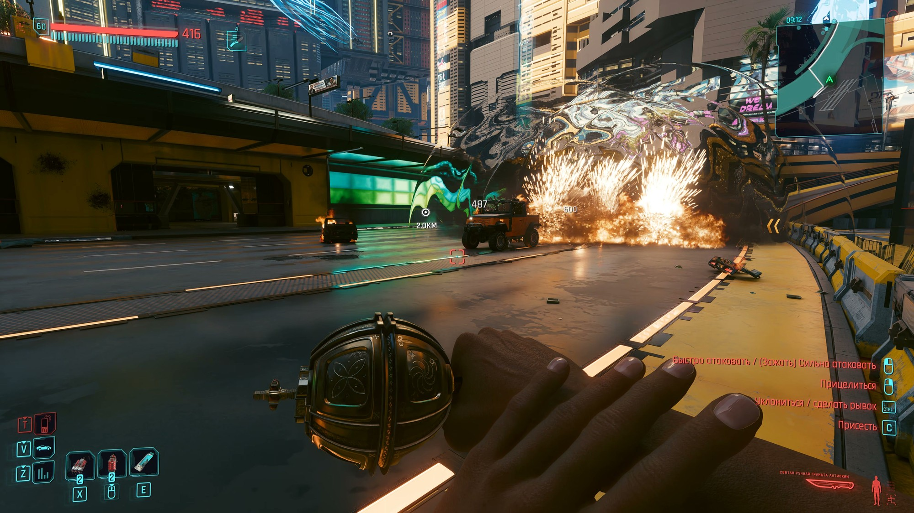
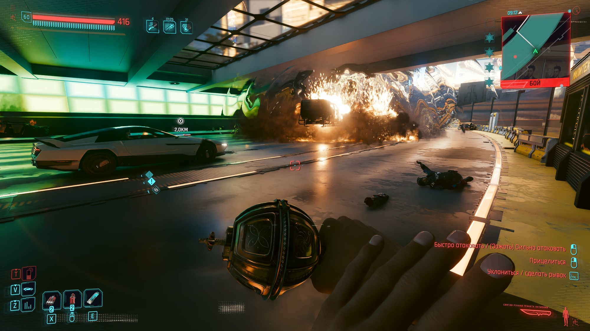
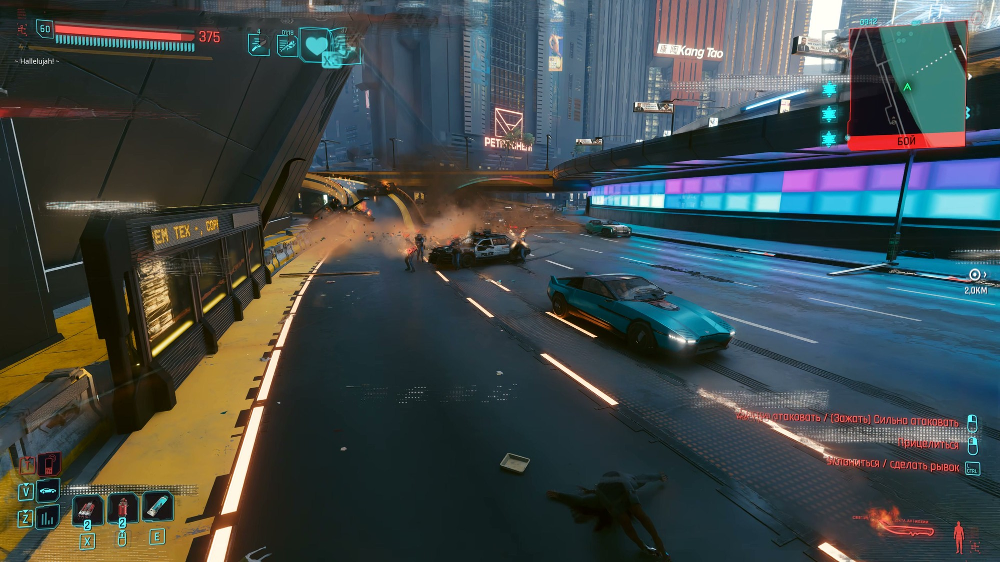
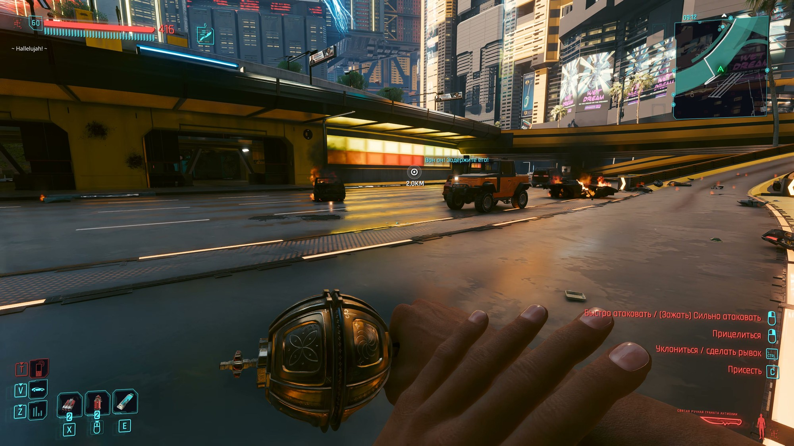
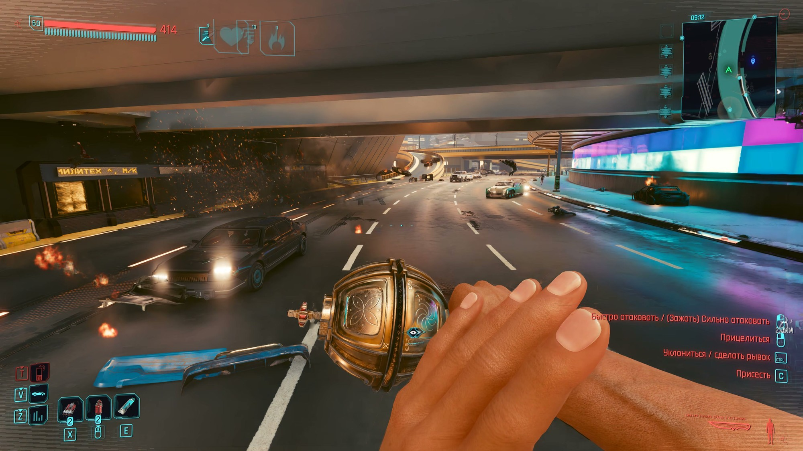
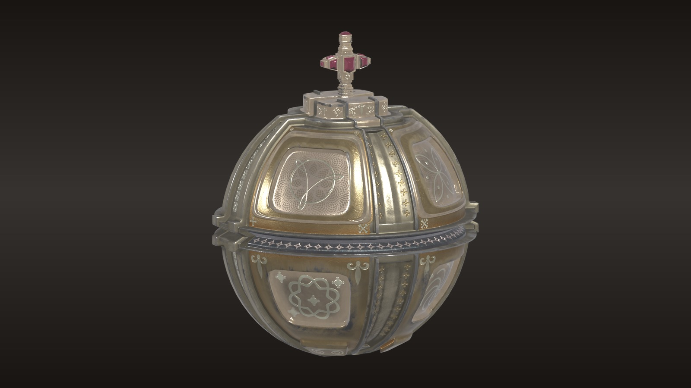

# Holy Hand Grenade for Cyberpunk 2077

The Holy Hand Grenade of Antioch in Night City. Throw it, count to three, hear the choir sing "Hallelujah" — and
watch everything around it go flying: people, cars and whatever else is not nailed down.

**Download:** the ready-to-install archive is in
[Releases](https://github.com/perseval-BLR/Cyberpunk2077-Holy-Hand-Grenade/releases/latest) (Nexus Mods page coming
soon). This repository holds the source code and configuration; the 3D model, textures and sound ship only in the
archive.

> **Fan-made, non-commercial.** Not affiliated with or endorsed by Team17, Python (Monty) Pictures or CD PROJEKT RED.
> See [Disclaimer](#disclaimer) and [CREDITS](CREDITS.md).



| | |
|---|---|
|  |  |
|  |  |
|  |  |

## Features
- **A new item** in your inventory: the Holy Hand Grenade (a golden orb with a cross on a dark grip) with its own icon,
  name and description (English, Russian). It is added a few seconds after you load a save.
- **Thrown like a throwing knife**, but it flies like a grenade: bounces off walls and floors, rolls, knocks back off
  people it hits.
- **Three seconds after the throw** — counted on screen — the choir sings "Hallelujah" and it goes off.
- **A huge blast:** 19 m of game explosion damage; everyone within 9 m dies, further out they are hurt; all of them
  are thrown away from the blast as ragdolls.
- **Cars** caught by the blast explode and are tossed into the air one after another, nearest first.
- **Short cooldown:** the grenade is back in your hand about a second after the throw.

## Requirements
Tested with **Cyberpunk 2077 2.31** and these versions (newer ones should work):

| Mod | Tested version | Needed for | Link |
|---|---|---|---|
| Cyber Engine Tweaks | 1.37.1 | everything (the grenade's logic) | https://www.nexusmods.com/cyberpunk2077/mods/107 |
| RED4ext | 1.30.0 | ArchiveXL, TweakXL, Codeware, Audioware | https://www.nexusmods.com/cyberpunk2077/mods/2380 |
| redscript | — | Codeware, Audioware | https://www.nexusmods.com/cyberpunk2077/mods/1511 |
| ArchiveXL | 1.27.4 | the model, icon and texts | https://www.nexusmods.com/cyberpunk2077/mods/4198 |
| TweakXL | 1.11.5 | the item and the explosion | https://www.nexusmods.com/cyberpunk2077/mods/4197 |
| Codeware | 1.20.5 | the flying grenade model | https://www.nexusmods.com/cyberpunk2077/mods/7780 |
| Audioware | 1.9.9-rc.0 | the "Hallelujah" (optional: without it the grenade works silently) | https://github.com/cyb3rpsych0s1s/audioware/releases |

Single-player only. No other mods of the author are needed.

## Install from scratch
1. Make sure the game is updated (2.31) and has been started at least once.
2. Install the requirements above, in that order, each one as its own page says (Vortex / MO2, or extract each archive
   into the game folder — the one with `bin`, `archive`, `r6`). The first start after installing Cyber Engine Tweaks
   asks you to pick a key for its overlay.
3. Install this mod: Vortex / MO2 as usual, or extract `HolyHandGrenade-<version>.zip` into the game folder, so that
   you get:
   ```
   archive/pc/mod/HolyHandGrenade.archive
   archive/pc/mod/HolyHandGrenade.archive.xl
   bin/x64/plugins/cyber_engine_tweaks/mods/holygrenade/init.lua
   r6/tweaks/holygrenade.yaml
   r6/audioware/holygrenade/audios.yml
   r6/audioware/holygrenade/hallelujah.wav
   ```
4. Start the game and load a save. After a few seconds "Holy Hand Grenade added to the inventory" appears; equip it in
   a weapon slot like any knife.

## Controls
| Action | Default |
|---|---|
| Throw | as a throwing knife: aim (right mouse), then attack (left mouse) |
| Give the grenade again | CET overlay → Bindings → `holygrenade_give` |

## Uninstall
Delete the paths above (the `holygrenade` folders whole). The grenade disappears from the inventory on the next load.

## Troubleshooting
- **No grenade in the inventory:** open the CET overlay — if it does not open, Cyber Engine Tweaks is not installed
  or not up to date. Check the log (below): "item ... MISSING" means TweakXL or `r6/tweaks/holygrenade.yaml` is
  missing.
- **The grenade looks like a plain knife:** ArchiveXL or `HolyHandGrenade.archive(.xl)` is missing.
- **No "Hallelujah":** Audioware is not installed (or not up to date for your game version).
- **The game does not start after installing the requirements:** one of RED4ext / redscript / Codeware / ArchiveXL /
  TweakXL is older than your game version — update it.
- Log for bug reports: `bin/x64/plugins/cyber_engine_tweaks/mods/holygrenade/log.txt`.

## Known issues
- The thrown grenade uses the throwing knife's animation; in the hand it is held by the knife's grip.
- Vehicles are set off up to 6 per blast (more at once used to freeze the game in heavy traffic).

## Disclaimer
This is a free fan project made for fun. It is not affiliated with, endorsed or sponsored by Team17 Digital Ltd,
Python (Monty) Pictures Ltd or CD PROJEKT S.A. The Holy Hand Grenade of Antioch comes from *Monty Python and the Holy
Grail* (© Python (Monty) Pictures); the "Hallelujah" sound is the one from the *Worms* series (© Team17 Digital Ltd),
included as a non-commercial fan tribute with all rights remaining with its owner; *Cyberpunk 2077* belongs to
CD PROJEKT S.A. The 3D model is used under its Creative Commons license (see [CREDITS](CREDITS.md)). No money,
donations or premium access are tied to this mod.
**Rights holders:** if you want any content removed, open an issue at
https://github.com/perseval-BLR/Cyberpunk2077-Holy-Hand-Grenade or message perseval-BLR — it will be taken down
promptly.

## How it was made
Built by perseval-BLR together with Claude Code (Anthropic, model Claude Opus 5.5): research of the game's item,
projectile and explosion API, the grenade's own ballistics, the blast wave for people and cars, the model conversion
(Blender, WolvenKit) and the item files. Code: MIT (see [LICENSE](LICENSE)); third-party assets keep their own terms.

---

# Святая ручная граната для Cyberpunk 2077

Святая ручная граната Антиохийская в Найт-Сити: бросил, считаешь до трёх, хор поёт «Аллилуйя» — и всё вокруг
разлетается: люди, машины и всё, что не прибито.

- **Новый предмет** в инвентаре (иконка, название и описание на русском и английском) — появляется через несколько
  секунд после загрузки сохранения (или по клавише CET `holygrenade_give`).
- **Бросок как у метательного ножа** (прицел ПКМ, бросок ЛКМ), но летит как граната: отскакивает, катится.
- **Через 3 секунды** — хор «Аллилуйя» и взрыв: 19 м урона, в 9 м — смерть, людей отбрасывает рагдоллом; машины в
  радиусе взрываются и подлетают одна за другой. Граната снова в руке примерно через секунду.

**Требования:** Cyberpunk 2077 2.31, Cyber Engine Tweaks, RED4ext, redscript, ArchiveXL, TweakXL, Codeware; для звука —
Audioware (без него граната работает без хора). Ссылки — в таблице выше.

**Установка с нуля:** поставить требования по порядку из таблицы (каждое — по инструкции на его странице), затем
распаковать архив мода в папку игры (где `bin`, `archive`, `r6`) или установить через Vortex / MO2. Загрузить
сохранение — граната появится в инвентаре; экипировать её в слот оружия как нож.
**Удаление:** удалить файлы из списка выше. **Лог для отчётов об ошибках:**
`bin/x64/plugins/cyber_engine_tweaks/mods/holygrenade/log.txt`.

**Дисклеймер:** бесплатный фанатский мод, не связан с Team17, Monty Python и CD PROJEKT RED. Святая граната — из
«Монти Пайтон и Священный Грааль»; звук «Аллилуйя» — из серии Worms (© Team17), используется как некоммерческий
фанатский оммаж, все права у владельца. Модель — по лицензии CC BY 4.0 (см. CREDITS). Правообладатели могут запросить
удаление — контент будет удалён.
